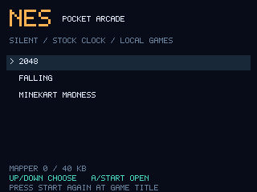
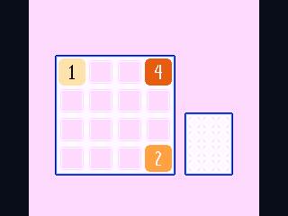
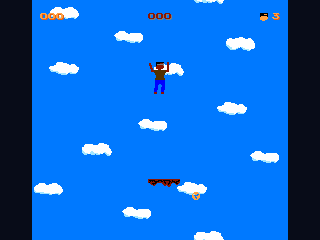
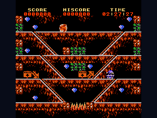

# NES for the GitHub Universe Badge

An experimental, silent NES emulator for the Universe 2026 Badger 2350.
Browse a small homebrew library, play with the badge controls, and return to the
supplied launcher with the physical Home button. The app uses the stock clock;
it does not overclock the badge or replace its firmware.

## On the badge

| Game library | 2048 |
| --- | --- |
|  |  |

| Falling | Minekart Madness |
| --- | --- |
|  |  |

Real 320 × 240 framebuffer captures from the badge, with verified byte counts and
checksums. These are native app captures, not browser mockups. A captured frame
does not establish full-speed play or complete game compatibility.

## Compatibility and current limits

The core supports selected iNES NTSC cartridges using mappers **0, 1, 2 and 3**,
plus **experimental standard MMC3B-style mapper 4** support.
Mapper support alone does not guarantee that a game will play correctly. This is
a small badge emulator with selective compatibility, not a replacement for a
full desktop emulator.

Mapper 4 accepts 32–512 KiB PRG ROM and 8–256 KiB CHR ROM with power-of-two
bank counts. MMC6, CHR RAM, four-screen boards and NES 2 headers are unsupported.
IRQ timing and rendering are approximate. More demanding games may run much
slower; neither full-speed play nor perfect raster effects are promised.

The following **historical measurements cover the bundled games on the original
mapper 0–3 core**, not mapper 4 performance. Short scripted checks on a **230 MHz
Badger 2350**, with **HIRES + VSYNC** on 2026-10-28, completed without emulator
errors for all three included games:

| Game | Final display counter (fps) | Emulated average (fps) |
| --- | ---: | ---: |
| 2048 | 15 | 29.38 |
| Falling | 18 | 35.26 |
| Minekart Madness | 22 | 46.27 |

Each measured interval lasted about 10 seconds after 720 warm-up frames. The
display figure is the final one-second counter; the emulated average covers the
whole interval. These results are **below full speed**. They are short scripted
checks, not full playthroughs or a battery-runtime test. Separately, on 2026-10-28
the owner confirmed the display, opening games with A/Start, directional controls,
holding Start + Select for 700 ms to pause, and returning to the game library.
See [HARDWARE.json](HARDWARE.json) for the method, firmware, core hash, individual
results and manual confirmation.

The local companion's NES page shows these facts and current build readiness.
It is an installation and controls page; it does not emulate NES gameplay in your
browser.

- **Silent operation:** no audio synthesis or audio buffers.
- **Safe cartridge loading:** unsupported headers, sizes and mapper combinations
  are rejected before entering the accelerated core.
- **Game saves:** supported battery-backed SRAM is kept separately from game ROMs.
  Untrusted full emulator-state files are not loaded.
- **Stock system preserved:** the download contains only this custom app, reviewed
  games, licenses and documentation.

## Included games

<!-- BUNDLED_GAMES_START -->

| Game | Author | License |
| --- | --- | --- |
| [Falling](https://github.com/xram64/falling-nes/tree/52dcb8a951200562e696dfc2aba5d4d14edd0078) | Jesse Williams (tragicmuffin) | [MIT](apps/nes/licenses/falling-MIT.txt) |
| [Minekart Madness](https://github.com/mhughson/mbh-cart/tree/70f7fc710c1135c07e62927af6653b1373e47faa) | Matthew Hughson | [MIT](apps/nes/licenses/minekart-MIT.txt) |
| [2048](https://github.com/jmgregory/2048-nes/tree/e80a02a4d60b4e017ccbb14ae9230f933b7c2a44) | Justin Gregory | [MIT](apps/nes/licenses/2048-MIT.txt) |

<!-- BUNDLED_GAMES_END -->

Exact reviewed ROM checksums and source revisions are recorded in
[games.json](apps/nes/games.json). Each game's license is included with the app.
The [game provenance guide](apps/nes/provenance/README.md) includes the original
download references, Minekart's checked header normalization, and 2048's pinned
source and reproduction script. Game code and artwork are unchanged; Minekart's
three metadata bytes are the only alteration to its author-published cartridge.

Commercial ROMs and personal ROM collections are not included. Add other games
only when you have permission to use them, and keep those additions local to your
badge. The repository build packages only explicitly reviewed game files.

## Install in five steps

You need a **GitHub Universe 2026 Badger 2350**, its supplied firmware, and a USB
cable that carries data. No firmware flashing is required.

1. Download the repository using **Code → Download ZIP**, then extract it.
2. Open the badge's **USB Disk / Mass Storage** app and connect the USB cable.
   Wait for the **BADGER** drive to appear.
3. Back up any existing `apps/nes/` folder. Copy only the complete **`nes`** folder
   from this repository's `apps/` directory into **`BADGER/apps/`**. Keep every
   module, game, license and asset together.
4. Wait for copying to finish, safely eject the drive, then restart the badge.
5. Open **NES**, choose a game with Up/Down, and press A or Start to open it.
   Release the opening button, then press Start at the game's title screen when
   prompted to begin play.

The final path is `BADGER/apps/nes/__init__.py`. The BADGER root already
represents the system volume; do not create another nested `system` directory.
Keep all stock apps, credentials, settings and unrelated files. Do not replace
the whole apps directory, format the drive, or flash a UF2.

Before updating or rolling back, follow the backup steps below. Replace only the
NES app files, retain your separately backed-up local ROMs, and preserve SRAM.
To uninstall, remove only `apps/nes/`; preserve separate save data unless you
intentionally want to reset progress.

## Adding your own games and keeping them through updates

The installed app can discover user-supplied `.nes` files. Use games you have
permission to use; loading a local file does not add it to this repository's
reviewed catalog or establish compatibility.

1. Pause any running game to save SRAM, resolve any **SAVE FAILED** message, then
   open USB Disk / Mass Storage.
2. Keep a private backup of your ROM on your computer. Copy only the additional
   `.nes` file into **`BADGER/apps/nes/roms/`**, using a distinct filename. Keep
   existing games and app files; do not replace the whole `roms` folder.
3. Safely eject, restart the badge, and open NES. Choose the local game from its
   library. The loader reports unsupported formats or mapper combinations.

Before an app update, back up the existing `apps/nes/` folder, including your
local games, outside this source repository. Back up SRAM separately from
**`/state/nes_badge/`** using filesystem/serial access that can read that native
path. It may not be visible on the BADGER USB drive: copying the app folder alone
does not back up SRAM. Keep its filenames and file contents unchanged.

Install the updated app, then retain or restore your local ROM files into its
`roms/` folder from the private backup. Preserve `/state/nes_badge/` in place;
restore a verified backup only when recovery is needed. An update should not
format storage or reset saves. SRAM identity depends on ROM contents, so keep the
same ROM bytes when continuing a saved game.

Repository builds and the companion's downloads contain only the explicitly
allowlisted games. They do not collect additional games from your badge. Keep
local ROMs, their screenshots and metadata, saves, and device backups out of
source repositories and shared packages.

## Controls

Use the labels on the printed NES control card:

| Printed control | During a game |
| --- | --- |
| Directional cross | NES D-pad |
| A | NES A / confirm |
| B | NES B |
| Start | NES Start |
| Select | NES Select |
| Hold Start + Select for 0.7 seconds | Open app pause menu |
| Physical Home button | Return to the supplied launcher |

The badge's separate physical Select button also acts as A. The card's Start
control and physical Home button have different roles. A + B can be held together
without opening the pause menu.

In the library, **Up / Down** chooses a game and **A or Start** opens it. Release
the opening button, then press **Start** at its title screen when prompted.
In the app pause menu, **Up / Down** chooses an option, **A** confirms,
and **B** resumes the game. Release both pause-chord pads before pausing again.

During play, Start may toggle the game's own pause. Press it again to resume if
the game uses Start for pause. This differs from the app menu opened by holding
Start + Select for 0.7 seconds.

Pause before using physical Home so the app can save battery-backed SRAM. If
**SAVE FAILED** appears, resolve the storage problem before leaving; the physical
Home button can still exit through the stock launcher. Failed saves retain SRAM
in memory but cannot protect it after power loss.

## Build and test

Python 3.9+ is needed only for local testing and packaging:

```sh
python3 -m unittest discover -s tests -v
python3 build.py
```

The build creates `dist/nes-badge.zip`. It contains only the allowlisted app,
reviewed game files, licenses and installation documents. Game checksums must
match the reviewed catalog; adding an unrelated ROM to the source directory does
not add it to the package. The build also verifies every included provenance
file against its pinned hash. Personal configuration, account data and save files
are excluded. Run optional game reproduction tools in a separate working copy;
their generated objects and rebuilt cartridges are not export inputs.

## Troubleshooting

- **No BADGER drive:** open USB Disk / Mass Storage and use a data-capable cable.
- **App missing:** check the exact folder path and avoid double-nested folders.
- **Game rejected:** check the cartridge format and supported mapper/size limits.
  Renaming a ROM does not make an unsupported cartridge compatible.
- **Movement or jumping seems inactive:** a title screen or automatic demo may
  be showing. Release the opening button, then press Start to begin. If the game
  is paused, press Start again according to its own controls.
- **Visual errors or slow play:** compatibility and speed are game-dependent.
  Demanding mapper 4 games can be substantially slower. Pause to save before
  using physical Home to leave the app.
- **No sound:** the emulator is intentionally silent.

## Credits and maintenance

**Created with AI by DChevrier1.** The accelerated core derives from Steve
Francia's MIT-licensed work. See [upstream provenance](apps/nes/UPSTREAM.md), the
[upstream license](apps/nes/LICENSE_upstream.txt), and [NOTICE.md](NOTICE.md).
NES is a Nintendo trademark; this unofficial app is not endorsed by Nintendo,
GitHub or Pimoroni.

Update README/help and relevant verification with each completed change. Keep
personal ROM collections, saves and device backups outside version control.
